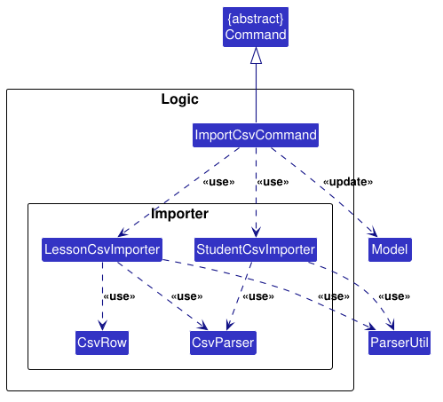
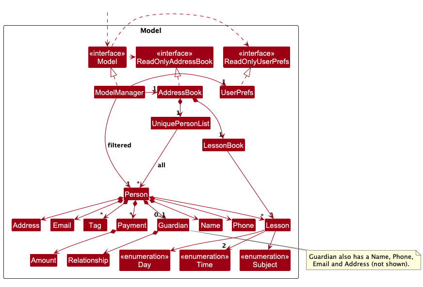
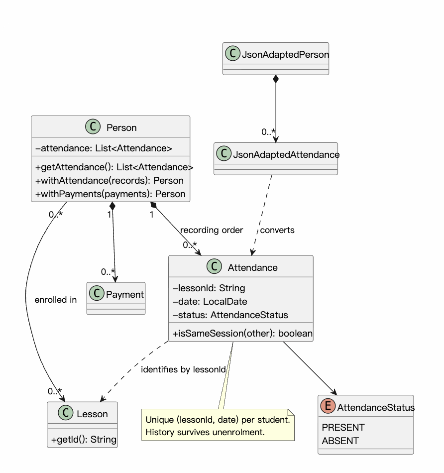
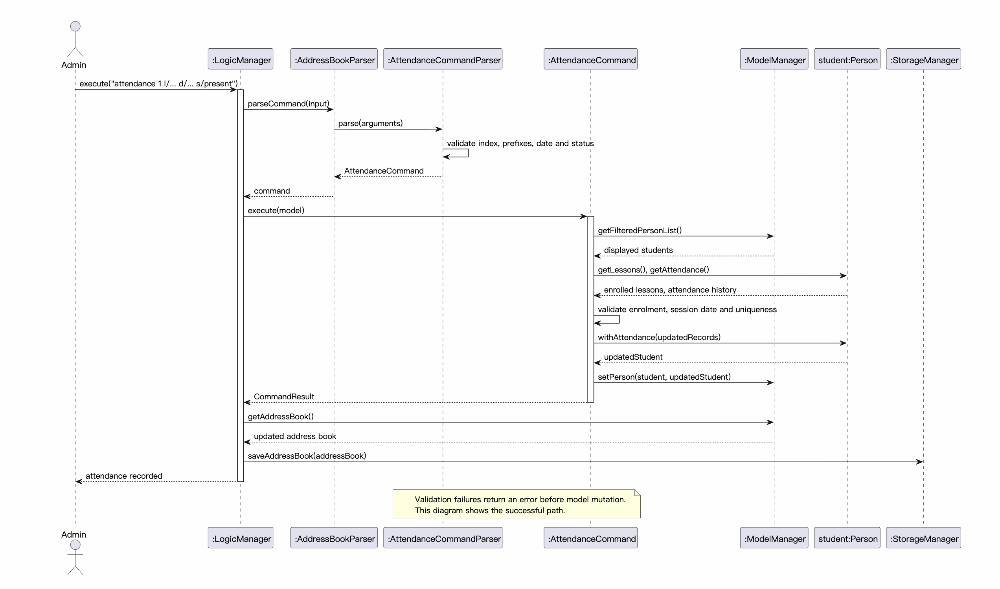
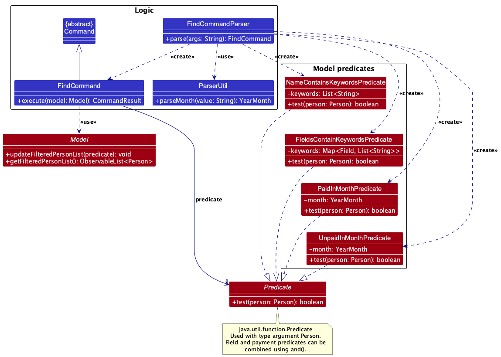
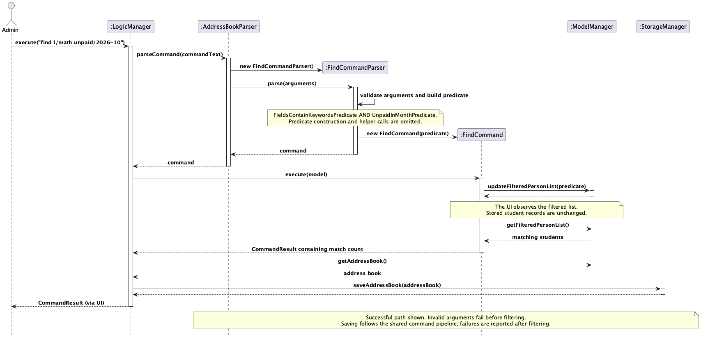

* Table of Contents
{:toc}

--------------------------------------------------------------------------------------------------------------------

## **Acknowledgements**

This project is based on the AddressBook-Level3 project created by the [SE-EDU initiative](https://se-education.org).

--------------------------------------------------------------------------------------------------------------------

## **Setting up, getting started**

Refer to the guide [_Setting up and getting started_](SettingUp.md).

--------------------------------------------------------------------------------------------------------------------

## **Design**

<div markdown="span" class="alert alert-primary">

:bulb: **Tip:** The `.puml` files used to create diagrams are in `docs/diagrams`. Refer to the [_PlantUML Tutorial_ at se-edu/guides](https://se-education.org/guides/tutorials/plantUml.html) to learn how to create and edit diagrams.
</div>

### Architecture


The ***Architecture Diagram*** given above explains the high-level design of the App.

The following provides a quick overview of the main components and their interactions.

**Main components of the architecture**

**`Main`** (consisting of classes [`Main`](https://github.com/se-edu/addressbook-level3/tree/master/src/main/java/seedu/address/Main.java) and [`MainApp`](https://github.com/se-edu/addressbook-level3/tree/master/src/main/java/seedu/address/MainApp.java)) is in charge of the app launch and shut down.
* At app launch, it initializes the other components in the correct sequence, and connects them up with each other.
* At shut down, it shuts down the other components and invokes cleanup methods where necessary.

The bulk of the app's work is done by the following four components:

* [**`UI`**](#ui-component): The UI of the App.
* [**`Logic`**](#logic-component): The command executor.
* [**`Model`**](#model-component): Holds the data of the App in memory.
* [**`Storage`**](#storage-component): Reads data from, and writes data to, the hard disk.

[**`Commons`**](#common-classes) represents a collection of classes used by multiple other components.

**How the architecture components interact with each other**

The *Sequence Diagram* below shows how the components interact with each other for the scenario where the user issues the command `delete 1`.


Each of the four main components (also shown in the diagram above),

* defines its *API* in an `interface` with the same name as the Component.
* provides its functionality through a concrete `{Component Name}Manager` class that implements the corresponding API interface.

For example, the `Logic` component defines its API in `Logic.java` and implements it in `LogicManager.java`. Other components interact with a component through its interface rather than its concrete class, preventing them from coupling to that component's implementation, as illustrated in the following partial class diagram.


The sections below give more details of each component.

### UI component

The **API** of this component is specified in [`Ui.java`](https://github.com/se-edu/addressbook-level3/tree/master/src/main/java/seedu/address/ui/Ui.java)


The UI consists of a `MainWindow` and its parts, such as `CommandBox`, `ResultDisplay`, `PersonListPanel`, and `StatusBarFooter`. All of these, including `MainWindow`, inherit from the abstract `UiPart` class, which captures common behavior among classes that represent visible GUI parts.

The `UI` component uses the JavaFX UI framework. The layouts of these UI parts are defined in matching `.fxml` files in `src/main/resources/view`. For example, [`MainWindow.fxml`](https://github.com/se-edu/addressbook-level3/tree/master/src/main/resources/view/MainWindow.fxml) specifies the layout of [`MainWindow`](https://github.com/se-edu/addressbook-level3/tree/master/src/main/java/seedu/address/ui/MainWindow.java).

The `UI` component,

* executes user commands using the `Logic` component.
* listens for changes to `Model` data so that the UI can be updated with the modified data.
* keeps a reference to the `Logic` component, because the `UI` relies on the `Logic` to execute commands.
* depends on some classes in the `Model` component because it displays `Person` objects from the model.

`PersonListPanel` renders each student using `PersonCard` and `PersonListCard.fxml`.
The card reads `Person#getGuardian()` and displays the guardian's five fields in a labelled
section below the student's details and lessons. Guardian labels wrap long values.
For legacy records with an empty guardian, the card hides and unmanages the detail container
and displays `No guardian information recorded.` instead. `PersonListPanel` recreates cards
when model entries change, so guardian edits appear without restarting the application.

### Logic component

**API** : [`Logic.java`](https://github.com/se-edu/addressbook-level3/tree/master/src/main/java/seedu/address/logic/Logic.java)

Here's a (partial) class diagram of the `Logic` component:


The sequence diagram below illustrates the interactions within the `Logic` component, taking `execute("delete 1")` API call as an example.


<div markdown="span" class="alert alert-info">:information_source: **Note:** The lifeline for `DeleteCommandParser` should end at the destroy marker (X), but due to a limitation of PlantUML, it continues to the end of the diagram.
</div>

How the `Logic` component works:

1. When `Logic` is called upon to execute a command, the command is passed to an `AddressBookParser` object, which in turn creates a parser that matches the command (e.g., `DeleteCommandParser`) and uses it to parse the command.
1. This results in a `Command` object (more precisely, an object of one of its subclasses e.g., `DeleteCommand`) which is executed by the `LogicManager`.
1. The command can communicate with the `Model` when it is executed (e.g. to delete a person).<br>
   Note that although this is shown as a single step in the diagram above for simplicity, the code can require several interactions between the command object and the `Model` to complete the operation.
1. The result of the command execution is encapsulated as a `CommandResult` object which is returned from `Logic`.

Here are the other classes in `Logic` (omitted from the class diagram above) that are used for parsing a user command:


How the parsing works:
* When called upon to parse a user command, the `AddressBookParser` class creates an `XYZCommandParser` (`XYZ` is a placeholder for the specific command name, e.g., `AddStudentCommandParser`). The parser uses the other classes shown above to parse the user command and create an `XYZCommand` object (e.g., `AddStudentCommand`). The `AddressBookParser` returns that object as a `Command` object.
* All `XYZCommandParser` classes, such as `AddStudentCommandParser` and `DeleteCommandParser`, implement the `Parser` interface so they can be treated similarly where appropriate, for example during testing.

The importer classes used by the `importcsv` command are shown below:



The `ImportCsvCommand` coordinates the import by using `LessonCsvImporter` to read lesson definitions and `StudentCsvImporter` to read student records. Both importers use `CsvParser` and `CsvRow` to parse and access CSV data, and use `ParserUtil` to validate values before creating model objects of Person, Guardian and Lesson.

#### CSV import format

The `importcsv` command reads `data/importlessons.csv` and `data/importstudents.csv`.
The lesson CSV must have the following columns:

```csv
year,subject,day,start_time,end_time,cost
```

Lesson IDs are not stored in the CSV. `LessonCsvImporter` derives each ID from the
parsed fields using `{year}-{subject}-{day}-{start_time}-{end_time}`. It validates
the lesson fields and rejects duplicate derived IDs.

The student CSV must have the following required columns:

```csv
name,phone,email,address
```

The optional columns are `tags`, `lessons`, and the complete set of guardian columns:
`guardian_name`, `guardian_phone`, `guardian_email`, `guardian_relationship`, and
`guardian_address`. Lesson references in the student CSV must match a lesson ID
derived from `importlessons.csv`.

Validation errors identify the source file and physical CSV row, including the
header row. For example:

```text
Unable to import data/importlessons.csv: Lesson CSV row 2: Day is any day of the week eg. MONDAY
```

### Model component
**API** : [`Model.java`](https://github.com/se-edu/addressbook-level3/tree/master/src/main/java/seedu/address/model/Model.java)




The `Model` component,

* stores the address book data i.e., all `Person` objects (which are contained in a `UniquePersonList` object).
* stores each distinct `Lesson` once in a `LessonBook`. Students who take the same lesson refer to the same `Lesson` definition.
* creates and deletes lesson definitions through `AddLessonCommand` and `DeleteLessonCommand`. Student creation and
  editing may only reference lessons already present in the `LessonBook`; they cannot create lesson definitions.
* versions lessons instead of overwriting them. A new `Lesson` has a random UUID as its stable internal `uid` and an immutable, non-empty list of `LessonRevision`s, each holding the year, subject, day, times, cost and the
  `effectiveFrom` billing month. The plain getters (`getId()`, `getCost()`, ...) describe the latest revision.
  `getRevisionFor(month)` and `getRevisionOn(date)` return the revision in effect at that time.
* edits lessons through `EditLessonCommand`, which adds a revision using `Lesson#withRevision` and then calls
  `Model#editLesson` to swap the new version into the `LessonBook` and every `Person` with the same `uid`.
  `from/` sets the revision's `effectiveFrom` and defaults to next month, or the latest pending month if later.
  A revision must take effect after the current billing month and no earlier than the latest revision.
  Only a future revision can be replaced in the same month. Year and subject cannot be edited.
  `LessonBook#addLesson` rejects duplicate UIDs without rewriting them. Enrolments and CSV imports reuse the
  catalog's canonical lesson objects, including their identities and revision histories. Legacy lessons without
  a UID use their earliest saved lesson ID as a migration UID; saving persists it for subsequent loads.
* computes fees per month: `Person#getFeesDue(month)` sums `Lesson#getCostFor(month)`, the cost of the revision in
  effect that month (zero if that revision is for another year). Payments store their own amount and month and are
  never rewritten, so editing a lesson's cost does not change whether earlier months are paid.
* reports all catalog lessons in `view /lesson`; the displayed frequency is the number of enrolled students and may be zero.
* represents each student as a `Person` with their contact details, tags, the lessons they take, an optional `Guardian`, and the fee `Payment`s recorded for them. A `Payment` holds an `Amount`, the billing month it is for and the date it was received.
* stores the `Person` objects selected by the current filter, such as search results, in a separate _filtered_ list. It exposes this list as an unmodifiable `ObservableList<Person>` that the UI can observe and bind to, so the UI updates when the list changes.
* stores a `UserPrefs` object that represents the user’s preferences (currently, just the GUI settings). This is exposed to the outside as a `ReadOnlyUserPrefs` object.
* does not depend on any of the other three components (as the `Model` represents data entities of the domain, they should make sense on their own without depending on other components)

<div markdown="span" class="alert alert-info">:information_source: **Note:** The alternative, arguably more object-oriented, design below keeps a unique list of tags in `AddressBook`, and each `Person` references tags from that list. This lets `AddressBook` maintain one `Tag` object per unique tag instead of each `Person` holding its own `Tag` objects.<br>


</div>


### Storage component

**API** : [`Storage.java`](https://github.com/se-edu/addressbook-level3/tree/master/src/main/java/seedu/address/storage/Storage.java)


The `Storage` component,
* can save both address book data and user preference data in JSON format, and read them back into corresponding objects.
* is implemented by `StorageManager`, which delegates the actual JSON file access to `JsonAddressBookStorage` and `JsonUserPrefsStorage` (one class per data file).
* depends on some classes in the `Model` component (because the `Storage` component's job is to save/retrieve objects that belong to the `Model`)

### Common classes

Classes used by multiple components are in the `seedu.address.commons` package.

--------------------------------------------------------------------------------------------------------------------

## **Implementation**

This section describes some noteworthy details on how certain features are implemented.

### Attendance tracking

Attendance follows the existing payment command and storage structure. Each `Person` owns a `List<Attendance>`
in recording order. An immutable `Attendance` contains a lesson ID, a `LocalDate` and an `AttendanceStatus`
(`PRESENT` or `ABSENT`). The lesson ID and date identify one session within that student's history.

The [attendance class diagram](diagrams/AttendanceClassDiagram.puml) and
[recording sequence diagram](diagrams/AttendanceSequenceDiagram.puml) describe the model and command flow.





1. `AddressBookParser` dispatches `attendance` to `AttendanceCommandParser`, which validates the displayed
   student index, required `l/`, `d/` and `s/` values, duplicate prefixes, calendar date and status.
2. `AttendanceCommand` resolves the student from `Model#getFilteredPersonList()`. It checks enrolment by lesson ID,
   verifies the session's year and weekday, and rejects a duplicate lesson/date pair regardless of status.
3. The command creates a new list and calls `Person#withAttendance`, then `Model#setPerson`. Validation failures
   occur before any model change. `Person` also enforces session uniqueness when constructed directly.
4. The existing logic/storage pipeline saves the updated address book. `JsonAdaptedPerson` stores an optional
   `attendance` array using `JsonAdaptedAttendance`. Older files without it load with empty attendance history.
   Invalid fields, null entries and duplicate sessions produce a data-loading error. Loading validates calendar
   dates but does not compare historical dates with the current lesson schedule, since lessons can be edited.

`viewattendance` displays numbered records from earliest to latest date without changing the model.
Both it and `deleteattendance` use `Person#getAttendanceInDateOrder()`, a stable date sort that retains recording
order for records on the same date. Deletion resolves the displayed number to the record and removes it from
the stored list. Both commands use the currently filtered student list, as payment commands do.
`withPayments`, `withAttendance` and `EditCommand` preserve the other history when copying a person.

Each `Attendance` stores the ID of the lesson revision in effect on its date (so the original timing is kept) and the
lesson's `uid`. `AttendanceCommand` accepts the lesson's current ID or any earlier one, validates the date against
`Lesson#getRevisionOn(date)`, and records the revision's ID and the `uid`. Linked records are compared for duplicates
by `uid` and date, so a session cannot be recorded twice under the old and new IDs. `AddressBook#editLesson` does not
modify attendance. `viewattendance` looks up the record's lesson by `uid` and, if its current ID differs, adds a
`Schedule changed to ...` line. `JsonAdaptedAttendance` stores `lessonUid`. Records from older files that have no
`lessonUid` are linked on load only when exactly one lesson has (or had) that lesson ID. Unresolvable or ambiguous
legacy records retain their original ID and date. Records with a known UID but an unrelated lesson ID are rejected;
unknown UIDs are retained because their lessons may have been deleted.
Attendance participates in `Person#equals` and `hashCode`, but does not change student identity (`isSamePerson`).

### Finding students

The class diagram below shows the main classes used by `find`. It uses the shared Logic (blue)
and Model (red) styling; `Predicate<Person>` is a Java library interface, not an EduReg class.



Source: [Find class diagram](diagrams/FindClassDiagram.puml).

`FindCommand` extends `Command` and holds one `Predicate<Person>`. `FindCommandParser` creates
the appropriate predicates and command, using `ParserUtil` to validate billing months.
The four concrete predicate classes implement the same interface, so the command does not need
to know which search type it executes. Combined field/payment searches use `Predicate#and`.
The diagram omits tokenizer helpers, the generic parser interface, and predicate implementation
details to focus on these relationships. Dashed arrows show dependencies or interface realization;
the solid triangle-headed arrow shows inheritance, and the solid arrow to the predicate shows
the stored reference.

The sequence diagram below follows parsing, command execution, filtering and saving for
`find l/math unpaid/2026-10`. UI forwarding and predicate-construction details are omitted
to focus on the main method calls.



Source: [Find command sequence diagram](diagrams/find-command-sequence.puml).

1. `FindCommandParser` validates the arguments and builds a `Predicate<Person>`. Without prefixes,
   it searches student names. With prefixes, it combines the selected fields and optional monthly
   payment status. Invalid arguments produce a parse error before the displayed filter changes.
2. `FindCommand` applies the predicate through `Model#updateFilteredPersonList` and returns the
   number of matching students. The UI observes the filtered list; no matching students gives an
   empty list and a count of zero, not an error. Each search filters the full student list.
3. After command execution, `LogicManager` saves the address book through the shared command
   pipeline. Searching changes the displayed filter, not the stored student records. The diagram
   assumes saving succeeds; a storage failure is reported as a command error after filtering.

Field matching is case-insensitive, with OR across keywords within a field and AND across fields.
Complete five-component lesson IDs match exactly; shorter lesson fragments match partially.
`unpaid/` matches positive outstanding fees. `paid/` requires positive fees with no outstanding
balance, including overpayments. Payment status covers all lessons in the billing year, not just
the lesson matched by `l/`; the two payment-status prefixes cannot be combined.

### Viewing student data

The [View command sequence diagram](diagrams/view-command-sequence.puml) gives a high-level overview of how the
UI, Logic, Model and Storage components handle `view`. With no field selector, the command updates the visible
student list to show all students. With a selector such as `/email`, it reads the students' values, counts distinct
values and returns the summary for display. The command pipeline then saves the address book.

Design decisions:

* Store the lesson's existing ID instead of copying a whole lesson or using its position in an unordered set.
  Historical IDs remain in attendance after unenrolment; loading does not require current enrolment.
* Reject duplicate sessions instead of silently overwriting them. Corrections require deleting the old record
  and recording the replacement, with both operations visible to the admin.
* Use an explicit date instead of defaulting to today to avoid accidentally recording the wrong session.
* Keep the alpha scope to present/absent on the lesson's regular weekday. Future dates are accepted;
  rescheduled sessions, bulk marking and attendance filtering are not implemented here.

Manual verification (use a disposable address book):

1. Enrol a student in `2026-MATH-MONDAY-TEN-ELEVEN-120`. Note their currently displayed index.
2. Run `attendance INDEX l/2026-MATH-MONDAY-TEN-ELEVEN d/2026-10-19 s/present`, then `viewattendance INDEX`.
   Expect one numbered `PRESENT` record.
3. Repeat with `s/absent` for the same date. Expect a duplicate warning and the original record unchanged.
4. Try `d/2026-10-20` (Tuesday), an invalid calendar date, or a lesson the student has not joined.
   Expect an error and no new record.
5. Record a payment and edit the student's phone. Restart the app. Both payment and attendance should remain.
6. Run `deleteattendance INDEX i/1`, restart, and verify that attendance is empty and payments remain.

### \[Proposed\] Undo/redo feature

#### Proposed Implementation

The proposed undo/redo mechanism is facilitated by `VersionedAddressBook`. It extends `AddressBook` with an undo/redo history, stored internally as an `addressBookStateList` and `currentStatePointer`. Additionally, it implements the following operations:

* `VersionedAddressBook#commit()` — Saves the current address book state in its history.
* `VersionedAddressBook#undo()` — Restores the previous address book state from its history.
* `VersionedAddressBook#redo()` — Restores a previously undone address book state from its history.

These operations are exposed in the `Model` interface as `Model#commitAddressBook()`, `Model#undoAddressBook()` and `Model#redoAddressBook()` respectively.

Given below is an example usage scenario and how the undo/redo mechanism behaves at each step.

Step 1. The user launches the application for the first time. The `VersionedAddressBook` will be initialized with the initial address book state, and the `currentStatePointer` pointing to that single address book state.


Step 2. The user executes `delete 5` command to delete the 5th person in the address book. The `delete` command calls `Model#commitAddressBook()`, causing the modified state of the address book after the `delete 5` command executes to be saved in the `addressBookStateList`, and the `currentStatePointer` is shifted to the newly inserted address book state.


Step 3. The user executes `addstudent n/David …​` to add a new person. The `addstudent` command also calls `Model#commitAddressBook()`, causing another modified address book state to be saved into the `addressBookStateList`.


<div markdown="span" class="alert alert-info">:information_source: **Note:** If a command fails its execution, it will not call `Model#commitAddressBook()`, so the address book state will not be saved into the `addressBookStateList`.

</div>

Step 4. The user now decides that adding the person was a mistake, and decides to undo that action by executing the `undo` command. The `undo` command will call `Model#undoAddressBook()`, which will shift the `currentStatePointer` once to the left, pointing it to the previous address book state, and restores the address book to that state.


<div markdown="span" class="alert alert-info">:information_source: **Note:** If the `currentStatePointer` is at index 0, pointing to the initial AddressBook state, then there are no previous AddressBook states to restore. The `undo` command uses `Model#canUndoAddressBook()` to check if this is the case. If so, it will return an error to the user rather
than attempting to perform the undo.

</div>

The following sequence diagram shows how an undo operation goes through the `Logic` component:


<div markdown="span" class="alert alert-info">:information_source: **Note:** The lifeline for `UndoCommand` should end at the destroy marker (X), but due to a limitation of PlantUML, it continues to the end of the diagram.

</div>

Similarly, how an undo operation goes through the `Model` component is shown below:


The `redo` command does the opposite — it calls `Model#redoAddressBook()`, which shifts the `currentStatePointer` once to the right, pointing to the previously undone state, and restores the address book to that state.

<div markdown="span" class="alert alert-info">:information_source: **Note:** If the `currentStatePointer` is at index `addressBookStateList.size() - 1`, pointing to the latest address book state, then there are no undone AddressBook states to restore. The `redo` command uses `Model#canRedoAddressBook()` to check if this is the case. If so, it will return an error to the user rather than attempting to perform the redo.

</div>

Step 5. The user then decides to execute the command `list`. Commands that do not modify the address book, such as `list`, will usually not call `Model#commitAddressBook()`, `Model#undoAddressBook()` or `Model#redoAddressBook()`. Thus, the `addressBookStateList` remains unchanged.


Step 6. The user executes `clear`, which calls `Model#commitAddressBook()`. Since the `currentStatePointer` is not pointing at the end of the `addressBookStateList`, all address book states after the `currentStatePointer` will be purged. Reason: It no longer makes sense to redo the `addstudent n/David …​` command. This is the behavior that most modern desktop applications follow.


The following activity diagram summarizes what happens when a user executes a new command:


#### Design considerations:

**Aspect: How undo & redo execute:**

* **Alternative 1 (current choice):** Saves the entire address book.
  * Pros: Easy to implement.
  * Cons: May have performance issues in terms of memory usage.

* **Alternative 2:** Individual command knows how to undo/redo by
  itself.
  * Pros: Will use less memory (e.g. for `delete`, just save the person being deleted).
  * Cons: We must ensure that the implementation of each individual command is correct.

_{more aspects and alternatives to be added}_

### \[Proposed\] Data archiving

_{Explain here how the data archiving feature will be implemented}_


--------------------------------------------------------------------------------------------------------------------

## **Documentation, logging, testing, dev-ops**

* [Documentation guide](Documentation.md)
* [Testing guide](Testing.md)
* [Logging guide](Logging.md)
* [DevOps guide](DevOps.md)

--------------------------------------------------------------------------------------------------------------------

## **Appendix: Requirements**

### Product scope

**Target user profile**:

* is a member of the administrative staff at a small private tuition centre
* handles daily student enrollments, parent inquiries, class schedules, and fee updates
* prefers using rapid keyboard commands over clicking through multi-step GUI forms

**Value proposition**: Centralizes student-parent relationships, class rosters, fee payments, and educational records into a unified CLI tool, enabling tuition centre admins to update enrollments, log attendance, and track assignment submissions significantly faster than with multi-step GUI systems.


### User stories

Priorities: High (must have) - `***`, Medium (nice to have) - `**`, Low (unlikely to have) - `*`

#### 1st use

| Priority | As a … | I want to … | So that I can … |
| --- | --- | --- | --- |
| `***` | tuition centre admin | add a new student's details | maintain an up-to-date record of students enrolled at the tuition centre |
| `***` | tuition centre admin | search for a student by name | locate their record quickly |
| `***` | tuition centre admin | view a student's details | quickly retrieve information when handling an enquiry |
| `**` | tuition centre admin | enrol a student into a class | maintain accurate class rosters |
| `***` | tuition centre admin | remove a student's record | remove records that were created incorrectly |
| `**` | tuition centre admin | search for a student using their phone number or email address | identify them when I do not know their full name |
| `**` | tuition centre admin averse to changing my workflow | view a list of available features | try it to determine if I should switch to using the app |
| `**` | tuition centre admin new to this app | view helpful error messages | fix mistakes without having to refer back to the user manual |
| `**` | tuition centre admin | import existing student records from a CSV file | migrate my data without manually entering each student's details |
| `**` | tuition centre admin | find students by class | retrieve the relevant group of students quickly |
| `**` | tuition centre admin | record whether a student attended a lesson | keep an attendance record for the centre |
| `**` | tuition centre admin | record a student's fee payment | keep track of whether payment has been received |

#### 2nd use

| Priority | As a … | I want to … | So that I can … |
| --- | --- | --- | --- |
| `**` | tuition centre admin | identify students with outstanding fees | know which payments require follow-up |
| `**` | tuition centre admin returning to the app | view a list of available commands | find the command I need without recalling every command name |
| `**` | tuition centre admin returning to the app | view command syntax and examples | enter commands correctly when I have forgotten how to use them |

#### 10th use

| Priority | As a … | I want to … | So that I can … |
| --- | --- | --- | --- |
| `***` | tuition centre admin | distinguish between students with identical names | avoid accessing or updating the wrong contact |
| `***` | tuition centre admin | link a guardian profile directly to a student record | know who to contact for a specific student |
| `**` | tuition centre admin | load student records quickly | perform administrative tasks efficiently |
| `**` | tuition centre admin | edit a student's information | keep their details accurate and up to date |
| `**` | tuition centre admin who types quickly | search for a student by their partial name | locate a student's information during a live call in under 5 seconds |
| `**` | tuition centre admin | search for a contact by phone number | instantly identify who is calling before I answer the phone |
| `**` | tuition centre admin | assign tags to students | flexibly categorize students by tags |
| `*` | tuition centre admin | auto-complete commands using the Tab key | issue commands faster with minimal typos |
| `*` | tuition centre admin | view recent command history using arrow keys | repeat or modify previous commands without having to type them again |
| `**` | tuition centre admin | add detailed notes to a student profile | keep track of special requests or student's learning needs |

### Use cases

### Use cases

(For all use cases below, the **System** is `EduReg` and the **Actor** is the `user`, unless specified otherwise)

**Use case: UC01 - Add a student contact**

**MSS**

1. User requests to add a new student using `addstudent`, specifying the student's name, phone number, email and
   address, and all five mandatory guardian fields: name (`gn/`), phone (`gp/`), email (`ge/`), relationship (`gr/`)
   and address (`ga/`). Tags (`t/`) and existing lesson IDs (`l/`) are optional.
2. EduReg validates the input format, including the presence of all five non-blank guardian fields.
3. EduReg adds the new student to the student directory.
4. EduReg displays a success message showing the newly added student's details.

   Use case ends.

**Extensions**

* 2a. The provided details do not follow the required format (e.g., a missing or blank guardian field,
  invalid phone number, or malformed email).

    * 2a1. EduReg displays an error message specifying the formatting error and required command usage.

      Use case resumes at step 1.

* 2b. EduReg detects a duplicate student entry (a student with the same name already exists).

    * 2b1. EduReg displays an error message rejecting the duplicate entry.

      Use case resumes at step 1.

**Use case: UC02 - View student details**

**MSS**

1. User requests to list all students.
2. EduReg displays the list of students.
3. User views the student's details directly on the student card. The **Guardian** section shows the guardian's name,
   phone, email, relationship, and address, or `No guardian information recorded.` if none is recorded.

   Use case ends.

**Extensions**

* 2a. The student directory is empty.

    * 2a1. EduReg displays a message indicating that no students are present in the list.

      Use case ends.

**Use case: UC03 - Search student by name**

**MSS**

1. User requests to search for students by providing a name keyword or partial name.
2. EduReg searches for students whose names match the provided keyword(s).
3. EduReg updates the displayed list to show only matching students.
4. EduReg displays a summary message showing the number of matching students found.

   Use case ends.

**Extensions**

* 1a. The search keyword is missing or empty (e.g., `find n/`).

    * 1a1. EduReg displays an error message specifying that the name parameter cannot be empty and shows correct usage.

      Use case resumes at step 1.

* 1b. The search term contains invalid special characters.

    * 1b1. EduReg displays an error message stating acceptable name character formats.

      Use case resumes at step 1.

* 2a. No students match the search criteria.

    * 2a1. EduReg displays an empty list and indicates that 0 students were found.

      Use case ends.

**Use case: UC04 - Delete a student contact**

**MSS**

1. User requests to list students.
2. EduReg shows a list of students.
3. User requests to delete a specific student by specifying their index in the displayed list.
4. EduReg deletes the student from the directory.
5. EduReg displays a success message confirming the deletion.

   Use case ends.

**Extensions**

* 2a. The list is empty.

  Use case ends.

* 3a. The given index is invalid (e.g., non-integer, negative, or greater than current list size).

    * 3a1. EduReg displays an error message indicating that the specified index is invalid.

      Use case resumes at step 2.

**Use case: UC05 - Add or edit guardian details**

**MSS**

1. User requests to list students.
2. EduReg shows a list of students.
3. User requests to add or edit the guardian details of a student at a specific index by providing one or more guardian fields.
4. EduReg validates the index and guardian details.
5. EduReg attaches the guardian details to the specified student record, preserving any guardian fields that were not edited.
6. EduReg refreshes the display panel and shows a success message confirming the updated guardian details.

   Use case ends.

**Extensions**

* 2a. The student list is empty.

    * 2a1. EduReg displays an error message indicating no students are available.

      Use case ends.

* 4a. The specified student index is invalid or missing.

    * 4a1. EduReg displays an error message indicating an invalid index.

      Use case resumes at step 2.

* 4b. The parent details are incomplete or formatted incorrectly.

    * 4b1. EduReg displays an error message specifying the invalid or missing field.

      Use case resumes at step 2.

* 4c. The student has no guardian and only some guardian fields are provided.

    * 4c1. EduReg displays an error message requiring all five guardian fields to add a guardian.

      Use case resumes at step 2.

**Use case: UC06 - Edit a student's information**

**MSS**

1. User requests to list students.
2. EduReg shows a list of students.
3. User requests to edit a specific student in the displayed list, specifying the student's id and the details to update.
4. EduReg updates the student's information.
5. EduReg displays a success message showing the updated student's details.

   Use case ends.

**Extensions**

* 2a. The list is empty.

  Use case ends.

* 3a. The given id is missing or invalid.

    * 3a1. EduReg displays an error message.

      Use case resumes at step 2.

* 3b. No fields to update are provided.

    * 3b1. EduReg displays an error message indicating that at least one field to update must be provided.

      Use case resumes at step 3.

* 3c. The provided details are formatted incorrectly.

    * 3c1. EduReg displays an error message specifying the invalid field or command format.

      Use case resumes at step 3.

* 3d. The updated details would create a duplicate student entry.

    * 3d1. EduReg displays an error message rejecting the duplicate entry.

      Use case resumes at step 3.

**Use case: UC07 - Clear all student records**

**MSS**

1. User requests to clear all student records.
2. EduReg removes all student records from the student directory.
3. EduReg displays an empty student list and a success message confirming that the directory has been cleared.

   Use case ends.

**Extensions**

* 1a. The student directory is already empty.

    * 1a1. EduReg displays an empty student list and a success message confirming that the directory has been cleared.

      Use case ends.

### Non-Functional Requirements

**Compatibility and Portability**
1. Should work on any _mainstream OS_ (Windows, Linux, macOS) as long as it has Java `25` or above installed.
2. The software should work without requiring an installer.
3. The software should not depend on a remote server.
4. Should be packaged into a single JAR file.
5. JAR file size must fall below 100MB.
6. JAR file should not be unnecessarily bloated, ie. does not have largely unused libraries.
7. External software used must be:
    1. free, open source
    2. have permissive license terms
    3. does not require installation by user
    4. does not require account creation

**Usability**
1. A user with above average typing speed for regular English text (i.e. not code, not system admin commands) should be able to accomplish most of the tasks faster using commands than using the mouse.
2. Should be used by only one user.
3. A new admin with basic computer literacy should be able to complete the core tasks within 15 minutes using only the user guide.

**Performance**
1. Should be able to hold up to 1000 persons without noticeable sluggishness in performance for typical usage.
2. The GUI should work well (i.e., should not cause any resolution-related inconveniences to the user) at:
    1. standard screen resolutions 1920x1080 and higher
    2. screen scales 100% and 125%
3. The GUI should be usable (i.e., all functions can be used even if the user experience is not optimal) at:
    1. resolutions 1280x720 and higher
    2. screen scales 150%
4. Saving of data to storage should not impact the user's ability to do other actions ie. no lag or blocking.

**Data Storage**
1. The data should be stored locally and should be in a human-editable text file.
2. Data should not be stored in a database management system (DBMS).
3. The app may not read or write files outside the home folder.
4. The app may not change any OS-level configuration settings.
5. Data saved to storage must be identical after closing and reopening the app on the same device.
6. If the app crashes or the save fails midway, the previous valid data file should not be corrupted.
7. Failed commands must leave existing data unchanged.

### Glossary

* **Attendance**: A record of whether a student attended a scheduled lesson.
* **Basic computer literacy**: The ability to perform common computer tasks, such as opening applications, entering text, and reading instructions.
* **Class roster**: The list of students enrolled in a particular class.
* **Command**: A text instruction entered by an administrator to perform an action in EduReg.
* **Command-line interface (CLI)**: An interface where users interact with software by entering text commands instead of clicking through graphical controls.
* **EduReg**: The command-driven student and tuition-centre administration application described in this guide.
* **Enrolment**: The process of registering a student for a class or tuition-centre programme.
* **Fee status**: The current payment state of a student's tuition fees, such as paid, pending, or overdue.
* **Graphical user interface (GUI)**: A visual interface that allows users to interact with software using elements such as windows, buttons, and menus.
* **Guardian**: An adult responsible for a student's care or education, such as a parent or legal guardian.
* **Human-editable**: A file format whose contents can be read and modified directly by a person using a text editor.
* **Home folder**: The folder containing the JAR file.
* **JAR file**: A Java Archive file that packages the application and its required resources for distribution.
* **Local storage**: Saving data on the same device that runs EduReg, without depending on a remote server.
* **Mainstream OS**: A commonly used operating system such as Windows, Linux, or macOS.
* **OS-Level configuration settings**: Settings specific to the operating system, and not the application.
* **Parent contact**: The contact information of a student's parent or guardian.
* **Permissive license terms**: License conditions that allow software to be used and distributed with few restrictions; trial licenses that require payment after a time or usage limit do not qualify.
* **Server**: A computer or service that provides data or application functionality to another computer over a network.
* **Database management system (DBMS)**: Software used to create, manage, and access databases; EduReg does not require one.
* **Remote server**: A server accessed over a network rather than running on the same device as EduReg.
* **Student record**: The collection of information associated with a student, including contact, class, attendance, fee, and educational details.

--------------------------------------------------------------------------------------------------------------------

## **Appendix: Instructions for manual testing**

Given below are instructions to test the app manually.

<div markdown="span" class="alert alert-info">:information_source: **Note:** These instructions only provide a starting point for testers to work on;
testers are expected to do more *exploratory* testing.

</div>

### Launch and shutdown

1. Initial launch

   1. Download the JAR file and copy it into an empty folder.

   1. Double-click the JAR file.<br>
      Expected: The GUI opens with a set of sample contacts. The window size may not be optimal.

1. Saving window preferences

   1. Resize the window to an optimal size. Move the window to a different location. Close the window.

   1. Relaunch the app by double-clicking the JAR file.<br>
       Expected: The most recent window size and location are retained.

1. _{ more test cases …​ }_

### Displaying guardian details with a student

1. Add a student in a disposable test address book:
   `addstudent n/Guardian Display Test p/98765432 e/student@example.com a/Student Road gn/Mary Tan gp/91234567 ge/mary@example.com gr/Mother ga/123 Example Road`.<br>
   Expected: The student's card shows a **Guardian** section containing `Name: Mary Tan`,
   `Phone: 91234567`, `Email: mary@example.com`, `Relationship: Mother`, and `Address: 123 Example Road`.
   The student's own contact details remain visible above it.

1. Run `find Guardian Display Test`, note the student's displayed index, then run
   `edit INDEX gp/92345678` using that index.<br>
   Expected: The guardian phone updates on the card immediately; the student's phone stays `98765432`.
   Run `view`. The updated guardian details should still appear with the same student.

1. Edit the guardian address to a long value, for example:
   `edit INDEX ga/123 Example Road Block 456 Unit 07 89 Singapore Near the Community Centre`.
   Narrow the window.<br>
   Expected: Guardian details wrap onto additional lines without overlapping the next card.

1. Load a valid legacy data file containing a student with no `guardian` field.<br>
   Expected: The student's card shows **No guardian information recorded.**, with no empty guardian field rows.
   Run `edit INDEX gn/Mary Tan gp/91234567 ge/mary@example.com gr/Mother ga/123 Example Road`.<br>
   Expected: The message is replaced by the five guardian fields immediately.

### Deleting a person

1. Deleting a person while all persons are being shown

   1. Prerequisites: List all persons using the `list` command, with multiple persons in the list.

   1. Test case: `delete 1`<br>
      Expected: The first contact is deleted from the list. The status message shows the deleted contact's details.

   1. Test case: `delete 0`<br>
      Expected: No person is deleted. The status message shows error details.

   1. Other incorrect delete commands to try: `delete`, `delete x`, `...` (where x is larger than the list size)<br>
      Expected: Similar to previous.

1. _{ more test cases …​ }_

### Saving data

1. Dealing with missing/corrupted data files

   1. _{Explain how to simulate missing or corrupted data files and state the expected behavior.}_

1. _{ more test cases …​ }_
