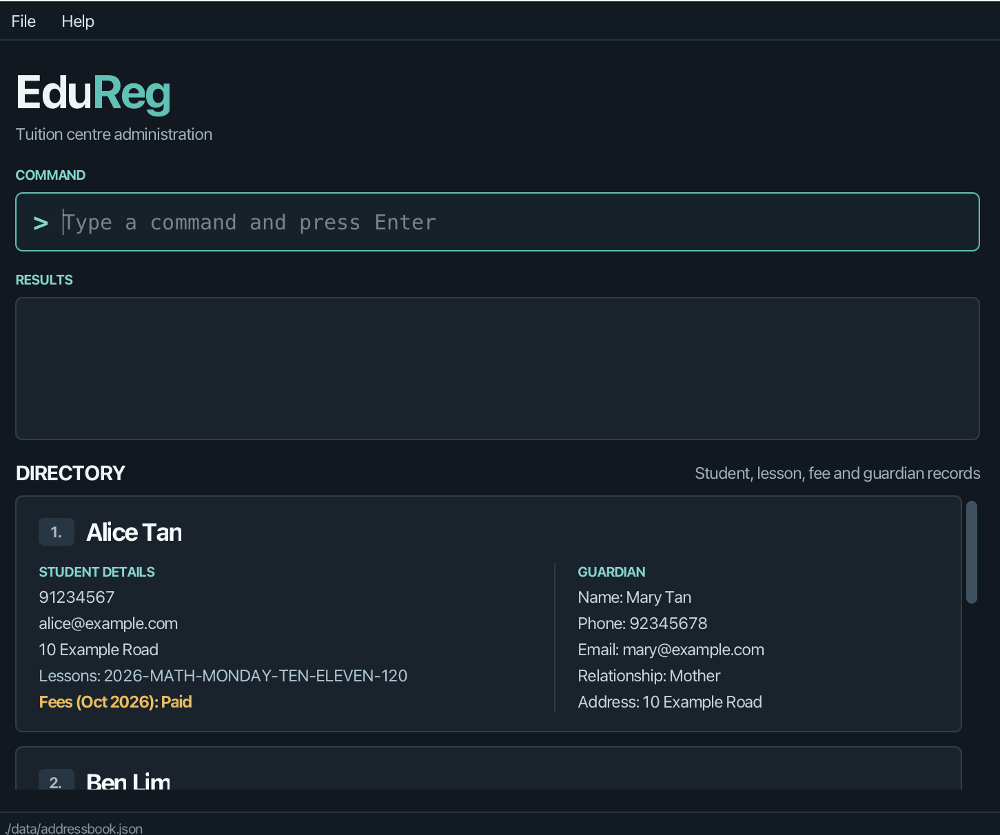

# EduReg

EduReg is a desktop application that centralizes student-parent relationships, class rosters, fee payments, and
educational records into a unified CLI tool, enabling tuition centre admins to update enrollments, log attendance, and
track assignment submissions significantly faster than multi-step GUI systems.

* Table of Contents
  {:toc}

--------------------------------------------------------------------------------------------------------------------

## Quick start

1. Ensure that Java `25` or later is installed on your computer. 
   **Mac users:** Ensure you have the precise JDK version
   prescribed [here](https://se-education.org/guides/tutorials/javaInstallationMac.html).

2. Download the latest `.jar` file from [here](https://github.com/AY2627S1-CS2103T-F10-3/tp/releases).

3. Copy the file to the folder you want to use as the _home folder_ for your AddressBook.

4. Open a terminal, `cd` to the folder containing the JAR file, and run `java -jar edureg.jar`. 
   A GUI similar to the one below should appear in a few seconds. Note how the app contains some sample data. 
   

5. Type a command in the command box and press Enter to execute it. For example, type **`help`** and press Enter to open
   the help window. 
   Some example commands you can try:

    * `view` : Lists all contacts.

    * `addstudent n/John Doe p/98765432 e/johnd@example.com a/John street, block 123, #01-01 gn/Mary Tan gp/91234567 ge/mary@example.com gr/Mother ga/123 Example Road`
      : Adds a contact named `John Doe` to the Address Book.

    * `delete 3` : Deletes the 3rd contact shown in the current list.

    * `clear` : Deletes all contacts.

    * `exit` : Exits the app.

6. Refer to the [Features](#features) section below for details of each command.

--------------------------------------------------------------------------------------------------------------------

## Features

**:information_source: Notes about the command format:** 

* Words in `UPPER_CASE` are the parameters to be supplied by the user. 
  For example, in `addstudent n/NAME`, replace `NAME` with a value such as `John Doe`.

* Items in square brackets are optional. 
  For example, `n/NAME [t/TAG]` can be used as `n/John Doe t/friend` or as `n/John Doe`.

* Items followed by `…`​ can appear zero or more times. 
  For example, `[t/TAG]…​` may be omitted, or written as `t/friend` or `t/friend t/family`.

* Parameters can be in any order. 
  For example, if the command specifies `n/NAME p/PHONE_NUMBER`, `p/PHONE_NUMBER n/NAME` is also acceptable.

* Extraneous parameters for commands that take no parameters, such as `help`, `view`, `exit`, and `clear`, are
  ignored. 
  For example, `help 123` is interpreted as `help`.

* If you are using a PDF version of this document, be careful when copying and pasting commands that span multiple lines
  as space characters surrounding line-breaks may be omitted when copied over to the application.

### Viewing help: `help`

Shows a message explaining how to access the help page.

Format: `help`

### Adding a student: `addstudent`

Adds a student to the address book.

Format:
`addstudent n/NAME p/PHONE_NUMBER e/EMAIL a/ADDRESS gn/GUARDIAN_NAME gp/GUARDIAN_PHONE ge/GUARDIAN_EMAIL gr/RELATIONSHIP
 ga/GUARDIAN_ADDRESS [t/TAG]…​ [l/LESSON]…​`

All five guardian fields (`gn/`, `gp/`, `ge/`, `gr/`, `ga/`) are mandatory when adding a student.
Each must be non-blank and supplied once. Guardian name, phone, email, and address follow the same
validation rules as the student's corresponding fields. Relationship accepts non-blank text such as
`Mother` or `Legal guardian`. Guardian details are saved with the student and can be changed with `edit`. Existing
records without guardian information remain readable.

:bulb: **Tip:**
A student can have any number of tags or lessons, including zero.

Lessons must first be created with `addlesson`. The `l/LESSON_ID` values in `addstudent` must
match lessons already in the lesson catalog; `addstudent` does not create new lessons.

### Adding a lesson: `addlesson`

Creates a reusable lesson definition in the lesson catalog.

Format: `addlesson y/YEAR s/SUBJECT d/DAY st/START_TIME et/END_TIME c/COST`

Example: `addlesson y/2026 s/MATH d/MONDAY st/TEN et/ELEVEN c/30`

Use the resulting lesson ID when enrolling students with `addstudent` or `edit`.

### Deleting a lesson: `deletelesson`

Removes a lesson from the lesson catalog and unenrols it from all students.

Format: `deletelesson LESSON_ID`

Example: `deletelesson 2026-MATH-MONDAY-TEN-ELEVEN`

The student's recorded attendance and payments are retained, but the deleted lesson no longer
contributes to enrolled-class fee summaries.

**Lessons** \
Defined in the form `{year}-{subj}-{day}-{starttime}-{endtime}-{cost}`
where:

- year is in the form yyyy eg. 2026
- subj (subject) is either `ENGLISH`, `MATH` or `SCIENCE`
- day is any day of the week, eg. `MONDAY`
- starttime and endtime are any hour between 10am to 7pm in 24h time eg. TEN for 10am and THIRTEEN for 1pm
- cost is any non-negative integer

Examples:

* `addstudent n/John Doe p/98765432 e/johnd@example.com a/John street, block 123, #01-01 gn/Mary Tan gp/91234567 ge/mary@example.com gr/Mother ga/123 Example Road l/2026-ENGLISH-MONDAY-TEN-ELEVEN-30`
* `addstudent n/Betsy Crowe t/friend e/betsycrowe@example.com a/Crow Street p/1234567 t/low-income gn/Jerry Crowe gp/92010200 ge/jcroww@example.com gr/Father ga/Crow Street`

### Viewing persons and contact values: `view`

With no selector, shows all persons in the address book. An optional selector shows each
distinct value and the number of contacts that have it. Summaries include all saved contacts,
regardless of the current view filter, and sort values alphabetically. Each tag is counted
separately.

Format: `view [/name | /phone | /email | /address | /tag | /lesson]`

Examples:

* `view /email` shows each distinct email and its frequency.
* `view /address` shows each distinct address and its frequency.
* `view /tag` shows each tag and how many contacts have it.
* `view /lesson` shows each distinct lesson and how many students are enrolled in it.

**Guardian details on student cards**

Each student card includes a **Guardian** section below the student's details and lessons.
It displays the guardian's name, phone, email, relationship to the student, and address,
with a label for each field to distinguish these details from the student's own contact information.
Long guardian details wrap onto additional lines.

Use `view` to show all students, or `find NAME` to find a student and see their guardian on the same card.
After `addstudent` or `edit`, the card displays the saved guardian details immediately.

Older records without a guardian show **No guardian information recorded.**
See [Editing a person](#editing-a-person-edit) to add or update guardian details.

### Editing a person: `edit`

Edits an existing person in the address book.

Format:
`edit INDEX [n/NAME] [p/PHONE] [e/EMAIL] [a/ADDRESS] [gn/GUARDIAN_NAME] [gp/GUARDIAN_PHONE] [ge/GUARDIAN_EMAIL] [gr/RELATIONSHIP] [ga/GUARDIAN_ADDRESS] [t/TAG]…​ [l/LESSON]…​`

* Edits the person at the specified `INDEX`. The index refers to the index number shown in the displayed person list.
  The index **must be a positive integer** 1, 2, 3, …​
* At least one of the optional fields must be provided.
* Existing values will be updated to the input values.
* Guardian fields can be edited individually. Guardian fields that are not provided keep their existing values.
* If the student has no guardian (for example, a record created before guardians were required), you must provide
  all five guardian fields (`gn/`, `gp/`, `ge/`, `gr/`, `ga/`) to add one.
* When editing tags, all of the person's existing tags are removed; adding tags is not cumulative.
* To remove all of a person's tags, enter `t/` without a tag after it.
* When editing lessons, all of the person's existing lessons are replaced by the given lessons; adding lessons is not
  cumulative. Each lesson must already exist in the catalog; use `addlesson` first.
* To remove all of a person's lessons, enter `l/` without a lesson after it.

Examples:

* `edit 1 p/91234567 e/johndoe@example.com` Edits the phone number and email address of the 1st person to be `91234567`
  and `johndoe@example.com` respectively.
* `edit 2 n/Betsy Crower t/` Edits the name of the 2nd person to be `Betsy Crower` and clears all existing tags.
* `edit 3 gp/98765432 gr/Father` Edits the guardian phone number and relationship of the 3rd person to be `98765432` and
  `Father` respectively. (Note: this example requires the student to already have guardian information stored)
* `edit 1 l/2026-MATH-MONDAY-TEN-ELEVEN-30 l/2026-ENGLISH-WEDNESDAY-THIRTEEN-FOURTEEN-40` Replaces the lessons of the
  1st person with the two given lessons.
* `edit 2 l/` Removes all lessons of the 2nd person.

### Recording a fee payment: `pay`

Records a fee payment for a student.

Format: `pay INDEX amt/AMOUNT m/MONTH [d/DATE]`

* Records the payment for the student at the specified `INDEX`. The index refers to the index number shown in the
  displayed person list. The index **must be a positive integer** 1, 2, 3, …​
* `AMOUNT` is a positive whole number of dollars, for example `120`.
* `MONTH` is the billing month that the payment is for, in the form `yyyy-MM`, for example `2026-10`.
* `DATE` is the date the payment was received, in the form `yyyy-MM-dd`. If you leave it out, today's date is used.
* A student can make more than one payment for the same month, for example when paying in parts.
* After recording the payment, EduReg shows the fees due, the total paid and the amount still outstanding for that
  month.

**How monthly fees are calculated** \
A lesson's cost is its monthly fee. The fees due for a month are the sum of the costs of the student's lessons in
that month's year. For example, a student taking `2026-MATH-MONDAY-TEN-ELEVEN-30` and
`2026-ENGLISH-WEDNESDAY-THIRTEEN-FOURTEEN-40` owes $70 for each month of 2026.

:exclamation: **Caution:**
Fees are calculated from the student's current lessons. Editing a lesson's cost also changes the fees due for
earlier months.

Each student card shows the fees for the current month, either **Paid** or the amount outstanding. Students with no
lessons in the current year don't show a fees line.

Examples:

* `pay 1 amt/70 m/2026-10` records a $70 payment for October 2026 from the 1st student, received today.
* `pay 2 amt/30 m/2026-10 d/2026-10-03` records a $30 payment for October 2026 from the 2nd student, received on
  3 October 2026.

### Viewing a student's payments: `viewpayments`

Lists the payments recorded for a student, numbered in the order they were recorded.

Format: `viewpayments INDEX`

* Lists the payments of the student at the specified `INDEX`. The index **must be a positive integer** 1, 2, 3, …​
* Use the payment numbers shown here with `deletepayment`.

Example:

* `viewpayments 1` lists the payments of the 1st student.

### Deleting a payment: `deletepayment`

Deletes a payment that was recorded by mistake.

Format: `deletepayment INDEX i/PAYMENT_INDEX`

* Deletes the payment numbered `PAYMENT_INDEX` from the student at the specified `INDEX`.
* `PAYMENT_INDEX` is the number shown by [`viewpayments`](#viewing-a-students-payments-viewpayments).
  It **must be a positive integer** 1, 2, 3, …​

Example:

* `viewpayments 1` followed by `deletepayment 1 i/2` deletes the 2nd payment of the 1st student.

### Recording attendance: `attendance`

Records whether a student attended one scheduled lesson session.

Format: `attendance INDEX l/LESSON_ID d/DATE s/STATUS`

* `INDEX` is the student's positive integer index in the currently displayed list, including after `find`.
* The student must be enrolled in the specified lesson. `LESSON_ID` is the lesson's year, subject, weekday,
  start time and end time, **without the cost**. For a displayed lesson `2026-MATH-MONDAY-TEN-ELEVEN-120`,
  use `l/2026-MATH-MONDAY-TEN-ELEVEN`. Lesson IDs are case-sensitive.
* `DATE` is required in `yyyy-MM-dd` form and must match the lesson's year and weekday.
* `STATUS` is `present` or `absent`, case-insensitive. A session without a record is **not automatically absent**.
* Only one record is allowed for a student, lesson and date, even if the status differs. To correct a mistake,
  use `viewattendance` and `deleteattendance`, then record the corrected status.
* Attendance is saved with the student. Editing student details or changing lesson enrolments preserves the history.
  Payment commands also preserve attendance records.
* The alpha version accepts future session dates and only supports the lesson's regular weekday, not rescheduled sessions.

Examples (assuming student 1 is enrolled in the Monday Math lesson above):

* `attendance 1 l/2026-MATH-MONDAY-TEN-ELEVEN d/2026-10-19 s/present`
* `attendance 1 l/2026-MATH-MONDAY-TEN-ELEVEN d/2026-10-26 s/absent`

### Viewing attendance: `viewattendance`

Format: `viewattendance INDEX`

Lists the student's attendance records in recording order, with numbers starting at 1. Each entry shows the
lesson ID, date and status. If there are no records, EduReg displays `No attendance recorded.`
The command does not change the student list or any records.

Example: `viewattendance 1`

### Deleting attendance: `deleteattendance`

Format: `deleteattendance INDEX i/ATTENDANCE_INDEX`

Deletes the record numbered `ATTENDANCE_INDEX` in that student's `viewattendance` output. Both indexes must
be positive integers. Remaining records are renumbered, so view the records again before deleting another one.
Historical records can still be viewed and deleted after the student leaves the lesson.

Example: `viewattendance 1` followed by `deleteattendance 1 i/2` removes the second attendance record.

### Locating students by student or guardian details: `find`

Finds students using partial student names, student phone numbers, guardian names, or guardian phone numbers.

Format: `find KEYWORD [MORE_KEYWORDS]`

To find students with outstanding fees for a billing month, use `find unpaid/YYYY-MM`.

Use `find paid/YYYY-MM` for students with positive fees fully covered by payments, including overpayments.
Students with no fees due are excluded from both payment-status searches.
For example, `find l/math paid/2026-10` shows Maths students who have fully paid their total October fees.
Choose either `paid/` or `unpaid/` in one command; supplying both is rejected.

* `find unpaid/2026-10` includes students with no payment or only partial payment for October 2026.
* `find n/Alice unpaid/2026-10` requires both the name and outstanding-fee condition to match.
* `find l/math unpaid/2026-10` shows Maths students with outstanding total monthly fees,
  not necessarily unpaid fees for the Maths lesson alone.

Fully paid students, overpaid students and students with no fees due are excluded. Payments for other billing
months do not count. The calculation uses the existing payment feature and current enrolled lessons for that year.
This is independent of tags such as `unpaid`. Supply one complete month, for example `2026-10`;
empty values, invalid months and repeated `unpaid/` prefixes are rejected.

Use `l/` to find students by enrolled lesson ID, including a class roster:

* `find l/math` matches students enrolled in any lesson whose ID contains `math`.
* `find l/2026-MATH-MONDAY` matches students in the corresponding year, subject and day.
* `find l/2026-MATH-MONDAY-TEN-ELEVEN` shows that lesson's roster.
* `find l/math science` matches either subject; `find n/Alice l/math` requires both fields to match.

Lesson searches are case-insensitive and exclude cost. An ID with five hyphen-separated components
(`YEAR-SUBJECT-DAY-START-END`) must match the whole ID exactly; fewer components are matched as substrings.
Students without lessons do not match. Each student appears only once even if several enrolled lessons match.
Field-specific format: `find [n/KEYWORDS] [p/KEYWORDS] [e/KEYWORDS] [a/KEYWORDS] [t/KEYWORDS] [gn/KEYWORDS] [gp/KEYWORDS] [ge/KEYWORDS] [ga/KEYWORDS] [gr/KEYWORDS] [l/KEYWORDS]`

Additional fields support the same case-insensitive partial matching:

* `e/`: student email; `a/`: student address; `t/`: individual tag names.
* `ge/`: guardian email; `ga/`: guardian address; `gr/`: guardian relationship.
* `find e/school.com a/Tampines` requires both email and address to match.
* `find ge/example.com gr/mother` searches guardian details but returns students.
* `find t/friend scholarship` matches either tag fragment. Students without tags do not match.

`find t/unpaid` searches an explicitly assigned tag only, not calculated payment status.
Tag searches are substring searches, so `find t/paid` also matches the tag `unpaid`.

* The search is case-insensitive; for example, `hans` matches `Hans`.
* Keyword order does not matter; for example, `Hans Bo` matches `Bo Hans`.
* Without a prefix, the search considers only student names. `n/` searches student names, `p/` student phone numbers,
  `gn/` guardian names, and `gp/` guardian phone numbers. The additional prefixes above search their named fields.
* Partial matches are supported; for example, `lic` matches `Alice`, and `9123` matches `91234567`.
* With multiple prefixes, every specified field must match (`AND`). For example, `find n/Alice gp/9876` returns
  only students whose name contains `Alice` and whose guardian phone number contains `9876`.
* Within each field, any keyword may match (`OR`). For example, `find n/Alice Bob` matches student names containing
  either `Alice` or `Bob`. Use space-separated keywords after one prefix, rather than repeating it as `n/Alice n/Bob`.
* These rules combine: `find n/Alice Bob gp/9876` requires a student name containing either `Alice` or `Bob`,
  together with a guardian phone number containing `9876`.
* Supply at least one non-empty search value. Repeated or unsupported prefixes and mixing unprefixed keywords with
  prefixed criteria are rejected.
* Students without guardian details do not match guardian searches. Search results always show students.
* Unprefixed searches also use `OR` between name keywords; for example, `find Hans Bo` matches student names
  containing either `Hans` or `Bo`, such as `Hans Gruber` and `Bo Yang`.

Examples:

* `find John` returns `john` and `John Doe`
* `find n/Alice` searches student names containing `Alice`.
* `find n/Alice Bob` searches student names containing either `Alice` or `Bob`.
* `find p/9123` searches student phone numbers containing `9123`.
* `find gn/Mary` returns students whose guardian names contain `Mary`.
* `find gp/9876` returns students whose guardian phone numbers contain `9876`.
* `find n/Alice gp/9876` requires both the student name and guardian phone number to match.
* `find alex david` returns `Alex Yeoh`, `David Li` 
  

### Deleting a person: `delete`

Deletes the specified person from the address book.

Format: `delete INDEX`

* Deletes the person at the specified `INDEX`.
* The index refers to the index number shown in the displayed person list.
* The index **must be a positive integer** 1, 2, 3, …​

Examples:

* `view` followed by `delete 2` deletes the 2nd person in the address book.
* `find Betsy` followed by `delete 1` deletes the 1st person in the results of the `find` command.

### Clearing all entries: `clear`

Clears all entries from the address book.

Format: `clear`

### Exiting the program: `exit`

Exits the program.

Format: `exit`

### Saving the data

EduReg automatically saves data after every command. You do not need to save manually.

### Editing the data file

EduReg data is saved automatically as a JSON file `[JAR file location]/data/addressbook.json`. Advanced users are
welcome to update data directly by editing that data file.

:exclamation: **Caution:**
If your changes make the data file invalid, EduReg starts with an empty address book at the next run.
The invalid file remains on disk until you run a command (EduReg saves after every command).
Still, we recommend backing up the file before editing it. 
Furthermore, certain edits can cause the EduReg to behave in unexpected ways (e.g., if a value entered is outside of the acceptable range).
Therefore, edit the data file only if you are confident that you can update it correctly.

### Archiving data files `[coming in v2.0]`

_Details coming soon ..._

--------------------------------------------------------------------------------------------------------------------

## FAQ

**Q**: How do I transfer my data to another computer? 
**A**: Install the app on the other computer and overwrite the data file it creates with the data file from your
previous EduReg home folder.

--------------------------------------------------------------------------------------------------------------------

## Known issues

1. **When using multiple screens**, if you move the application to a secondary screen, and later switch to using only
   the primary screen, the GUI will open off-screen. The remedy is to delete the `preferences.json` file created by the
   application before running the application again.
2. **If you minimize the Help Window** and then run the `help` command (or use the `Help` menu, or the keyboard shortcut
   `F1`) again, the original Help Window will remain minimized, and no new Help Window will appear. The remedy is to
   manually restore the minimized Help Window.

--------------------------------------------------------------------------------------------------------------------

## Command summary

Action | Format, Examples
--------|------------------
**Add Lesson** | `addlesson y/YEAR s/SUBJECT d/DAY st/START_TIME et/END_TIME c/COST`  e.g., `addlesson y/2026 s/MATH d/MONDAY st/TEN et/ELEVEN c/30`
**Delete Lesson** | `deletelesson LESSON_ID`  e.g., `deletelesson 2026-MATH-MONDAY-TEN-ELEVEN`
**Add Student** | `addstudent n/NAME p/PHONE_NUMBER e/EMAIL a/ADDRESS gn/GUARDIAN_NAME gp/GUARDIAN_PHONE ge/GUARDIAN_EMAIL gr/RELATIONSHIP ga/GUARDIAN_ADDRESS [t/TAG]…​ [l/LESSON_ID]…​`
\  e.g., `add n/James Ho p/22224444 e/jamesho@example.com a/123, Clementi Rd, 1234665 t/friend t/colleague gn/Mary Tan gp/91234567 ge/mary@example.com gr/Mother ga/123 Example Road`
**Clear** | `clear`
**Delete** | `delete INDEX`  e.g., `delete 3`
**Edit** | `edit INDEX [n/NAME] [p/PHONE_NUMBER] [e/EMAIL] [a/ADDRESS] [t/TAG]…​ [l/LESSON_ID]…​ [gn/GUARDIAN_NAME] [gp/GUARDIAN_PHONE] [ge/GUARDIAN_EMAIL] [gr/RELATIONSHIP] [ga/GUARDIAN_ADDRESS]`  e.g., `edit 2 n/James Lee e/jameslee@example.com gp/91234567`
**Pay** | `pay INDEX amt/AMOUNT m/MONTH [d/DATE]`  e.g., `pay 1 amt/70 m/2026-10 d/2026-10-03`
**View Payments** | `viewpayments INDEX`  e.g., `viewpayments 1`
**Delete Payment** | `deletepayment INDEX i/PAYMENT_INDEX`  e.g., `deletepayment 1 i/2`
**Attendance** | `attendance INDEX l/LESSON_ID d/DATE s/STATUS`
**View Attendance** | `viewattendance INDEX`
**Delete Attendance** | `deleteattendance INDEX i/ATTENDANCE_INDEX`
**Find** | `find KEYWORD [MORE_KEYWORDS]` or field-specific searches (see `find` section)  e.g., `find e/example.com gr/mother`
**View** | `view [/name | /phone | /email | /address | /tag | /lesson]`
**Help** | `help`
